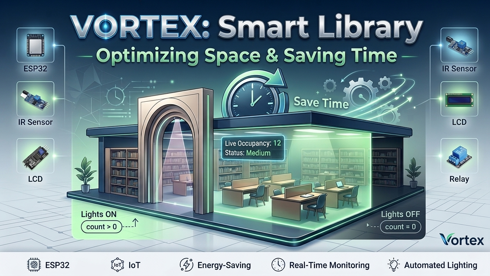

<div align="center">

# 📚 VORTEX: Smart Library Occupancy & Energy-Saving System



**An IoT energy-saving system built on ESP32, dual IR sensors, and automated relay control to optimize library space and eliminate electricity waste in real time.**


-00979D)


</div>

---

## 📑 Table of Contents

- [Overview](#-overview)
- [Features](#-features)
- [Hardware Components & Pin Mapping](#️-hardware-components--pin-mapping)
- [Prototype & Demo](#-prototype--demo)
- [System Logic & Operation](#️-system-logic--operation)
- [Repository Structure](#-repository-structure)
- [Getting Started](#-getting-started)
- [Contributing](#-contributing)
- [License](#-license)
- [Author](#-author)

---

## 🚀 Overview

The **Vortex Smart Library System** monitors library occupancy in real time and manages lighting automatically based on actual presence.

Two active IR sensors provide accurate people counting, while an ESP32 microcontroller acts as the core processor. The current status (`Empty`, `Medium`, `Crowded`) is shown on a 16x2 I2C LCD, and a relay module switches the lights on or off to maximize energy efficiency.

---

## ✨ Features

- **Real-time people counting** using entry and exit IR sensors.
- **Automatic lighting control** through a relay module: lights are on only when the space is occupied.
- **Live occupancy status** (`Empty` / `Medium` / `Crowded`) on a 16x2 I2C LCD.
- **Safe counting logic**: the counter never drops below zero.
- **Standalone operation** powered by rechargeable lithium batteries.

---

## 🛠️ Hardware Components & Pin Mapping

The components are mapped as defined in the firmware configuration:

| Component | ESP32 Pin / Interface | Description |
| :--- | :--- | :--- |
| **ESP32 Microcontroller** | System core | Main processing unit handling logic and system timing |
| **Entry IR Sensor** | `GPIO 27` | Detects visitors entering the library/zone |
| **Exit IR Sensor** | `GPIO 25` | Detects visitors exiting the library/zone |
| **Relay Module** | `GPIO 26` | Controls lighting power (**active-low**: `LOW` = ON, `HIGH` = OFF) |
| **LCD 16x2 (I2C Module)** | `SDA: GPIO 33`, `SCL: GPIO 32` | Displays real-time visitor count and status |
| **Power Source** | Lithium batteries | Rechargeable power supply for standalone operation |

---

## 📸 Prototype & Demo

**Prototype photos:**

- [Prototype – Angle 1](images/photo_2026-11-09_01-27-12.jpg)
- [Prototype – Angle 2](images/photo_2026-11-09_01-27-15.jpg)
- [Prototype – Angle 3](images/photo_2026-11-09_01-27-18.jpg)
- [Prototype – Angle 4](images/photo_2026-11-09_01-27-21.jpg)

🎥 **Demo video:** [Watch the demonstration](images/vid.MOV)

---

## ⚙️ System Logic & Operation

### 1. People Tracking
- **Entry detected** (`IR_ENTRY`): the counter increases (`count++`), the display updates, and the system waits until the sensor path is clear.
- **Exit detected** (`IR_EXIT`): the counter decreases (`count--`) only if `count > 0`, so the count never goes below zero.

### 2. Smart Lighting Control

| Condition | Relay State | Lights |
| :--- | :---: | :---: |
| Occupied (`count > 0`) | `LOW` | 💡 ON |
| Empty (`count == 0`) | `HIGH` | 🌙 OFF |

### 3. Dynamic LCD Status Categories

| Visitor Count | Status |
| :---: | :--- |
| `0 – 3` | **Empty** |
| `4 – 7` | **Medium** |
| `8+` | **Crowded** |

---

## 📂 Repository Structure

```text
Smart-Library-Occupancy-System/
│
├── docs/                          # Project report & presentation
│   ├── Project-Report.pdf
│   └── Project-Presentation.pdf
│
├── images/                        # Cover, hardware photos, and demo video
│   ├── cover.jpg
│   ├── photo_2026-11-09_01-27-12.jpg
│   ├── photo_2026-11-09_01-27-15.jpg
│   ├── photo_2026-11-09_01-27-18.jpg
│   ├── photo_2026-11-09_01-27-21.jpg
│   └── vid.MOV
│
├── README.md                      # Project documentation
└── Source-Code.cpp                # ESP32 Arduino C++ firmware
```

---

## 💡 Getting Started

### Prerequisites
- [Arduino IDE](https://www.arduino.cc/en/software) with the **ESP32 board package** installed
- An I2C LCD library for the 16x2 display (e.g., `LiquidCrystal_I2C`)

### Installation

1. **Hardware assembly:** connect the ESP32, IR sensors, relay module, and I2C LCD according to the [pin mapping table](#️-hardware-components--pin-mapping).
2. **Firmware upload:** open `Source-Code.cpp` in the Arduino IDE, select your ESP32 board and port, and upload the code.
3. **Serial monitor:** set the baud rate to `115200` to view debug output.
4. **Live observation:** watch the LCD for real-time occupancy counts and the automatic lighting response.

---

## 🤝 Contributing

Contributions, issues, and feature requests are welcome! Feel free to check the [issues page](../../issues) or submit a Pull Request to improve the system.

1. Fork the repository
2. Create your feature branch (`git checkout -b feature/your-feature`)
3. Commit your changes (`git commit -m "Add your feature"`)
4. Push to the branch (`git push origin feature/your-feature`)
5. Open a Pull Request

---

## 📜 License

This project is open-source and available under the [MIT License](https://opensource.org/license/mit).

---

## 👥 Author

**Alaa Arafa** — Developer
GitHub: [@AlaaArafa19](https://github.com/AlaaArafa19)